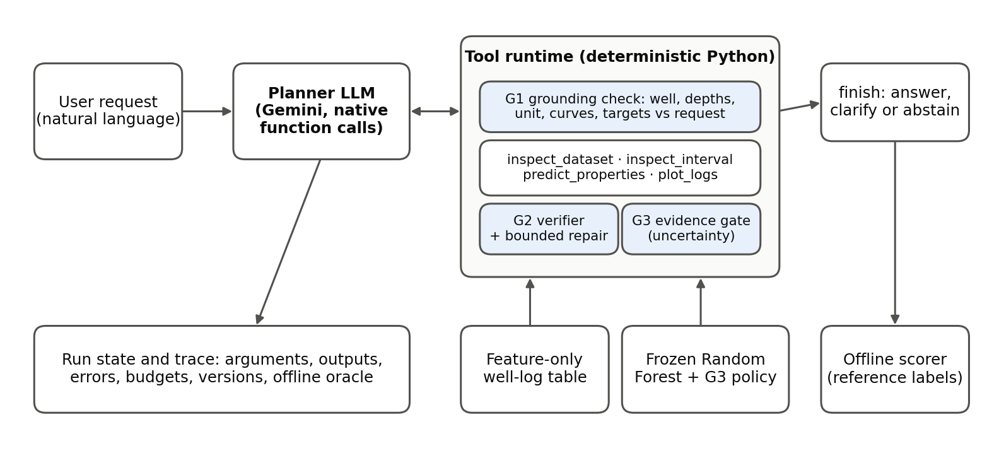
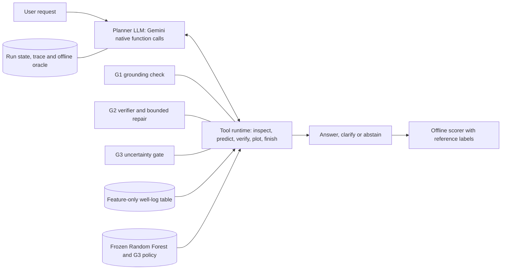
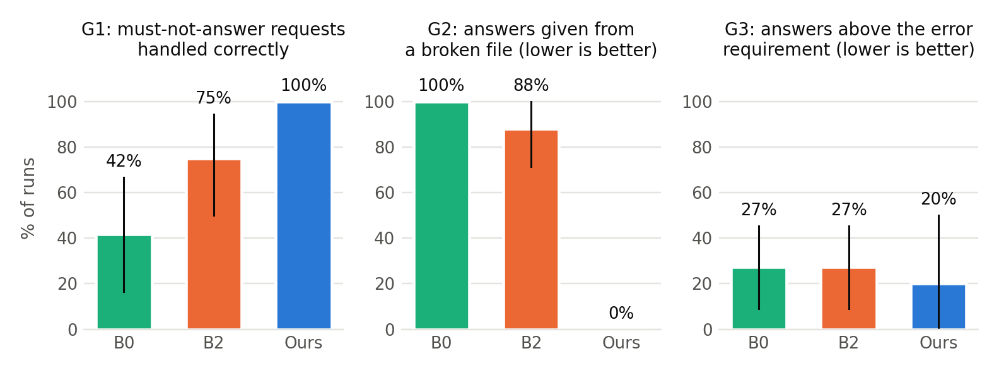

# Reliable Tool-Using Agents for Well-Log Analysis

AI4015 Agentic Artificial Intelligence, Fall 2026. Group G3-03, Phase 2 (final).

An LLM agent (Gemini) takes a plain-language request about well-log data and runs a fixed set of Python tools: it inspects the data, selects an interval, predicts porosity (PHIF), water saturation (SW) and shale volume (VSH) with a frozen Random Forest, checks the output file and answers, asks for clarification, or abstains. The LLM only chooses the next step; all numbers come from deterministic code.

The project builds on the base paper [LogACF](https://doi.org/10.1016/j.petsci.2026.05.031) and adds three switchable reliability components, one per research gap:

| Gap | Component | What it does |
|---|---|---|
| G1 semantic grounding | `src/subsurface_agent/gaps/grounding.py` | Checks that the well, depths, unit, curves and requested quantities in every tool call come from the user's own words; blocks guessed values and unsupported requests |
| G2 verification and repair | `src/subsurface_agent/gaps/verification.py` | Checks every prediction file (identity, values, recomputation with the frozen model) and regenerates a broken file, at most twice |
| G3 acceptance under weak evidence | `src/subsurface_agent/gaps/acceptance.py` | Measures the model's uncertainty for the interval and refuses to answer above a limit calibrated on the validation wells |

**Main result (50 test cases, 3 repeats):** task success 76.0% for the proposed system against 57.3% for a LogACF-style agent and 46.0% for a fixed non-agentic pipeline. G1 and G2 remove all unwarranted answers and all answers from broken files; G3 lowers the share of bad answers from 27.3% to 20.0% but refuses half of the acceptable intervals. Full results: [docs/RESULTS.md](docs/RESULTS.md).

## Architecture





- **Tools:** `inspect_dataset`, `inspect_interval`, `predict_properties`, `verify_predictions`, `plot_logs`, `finish`. Arguments are validated with Pydantic; there is no code execution, file-path argument or access to reference labels.
- **Budgets:** 10 planner turns, 14 tool calls and 3 tool errors per run.
- **State and trace:** every run saves its arguments, tool outputs, errors, token usage, versions, configuration and an offline `oracle` record (injected fault and final file validity, never shown to the planner).
- **Comparison systems:** B0 (`baselines/fixed_pipeline.py`), a fixed script with no LLM; B2 (`baselines/logacf_style.py`), a LogACF-style planner, executor and LLM reviewer with none of the three components.

More detail: [docs/ARCHITECTURE.md](docs/ARCHITECTURE.md).

## Installation

Python 3.11 to 3.13. No GPU is needed. PowerShell commands (on Linux or macOS use `.venv/bin/python`):

```powershell
git clone https://github.com/mehranwazir/ai4015-subsurface-agent.git
cd ai4015-subsurface-agent
python -m venv .venv
.\.venv\Scripts\python.exe -m pip install -r requirements-lock.txt
.\.venv\Scripts\python.exe -m pip install --no-deps -e .
.\.venv\Scripts\python.exe -m pytest -q
```

The 86 tests use small synthetic fixtures and a scripted planner; they need no dataset or API key. GitHub Actions runs them on Windows and Linux for every push.

### Data and model

```powershell
.\.venv\Scripts\python.exe -m subsurface_agent download      # pinned SPWLA 2021 archive, checksum verified
.\.venv\Scripts\python.exe -m subsurface_agent prepare       # feature table, splits, checksums, overlap check
.\.venv\Scripts\python.exe -m subsurface_agent baseline      # Random Forest and training-mean scores
```

The reference Random Forest (`models/random_forest.joblib`, SHA-256 `e24f305b…`) and the calibrated G3 policy (`models/g3_policy.json`) are committed. `baseline` keeps the reference file when a refit reproduces its predictions exactly. `calibrate-g3` recalibrates the G3 limit from the validation wells only.

## Configuration

Copy `.env.example` to `.env` and set:

| Variable | Meaning |
|---|---|
| `GEMINI_API_KEY` | Gemini API key (never commit it; `.env` and `.env.*` are ignored by Git) |
| `GEMINI_MODEL` | Model name, default `gemini-3.5-flash-lite` (used for all reported runs) |
| `INPUT_USD_PER_MILLION`, `OUTPUT_USD_PER_MILLION` | Optional prices, only used to estimate cost |

Other credentials files (for example `.env.keyB`) can be selected per experiment with `--env-file`.

System configurations (`--config` for `agent`, `--systems` for `experiment`):

| Name | Meaning |
|---|---|
| `full` | Proposed system: G1, G2 and G3 on (default) |
| `no_g1`, `no_g2`, `no_g3` | Full system with one component removed (ablation) |
| `b0` | Fixed non-agentic pipeline, no LLM |
| `b2` | LogACF-style planner, executor and LLM reviewer, no gap components |
| `phase1` | Behaviour of the recorded Phase 1 runs, used only for replay |

## Running the system

```powershell
.\.venv\Scripts\python.exe -m subsurface_agent agent "Predict PHIF, SW and VSH for well 3 from 10600 to 11000 ft and verify the result."
```

The command prints the run record and saves it under `logs/runs/<run-id>/` (`result.json`, `events.jsonl`, prediction CSV, optional plot). `--fault` injects one controlled fault into the first prediction file (`missing_file`, `corrupt_values`, `drop_rows`, `duplicate_rows`, `wrong_well`, `nan_values`, `stale_artifact`, or the benign `shuffle_rows`).

Replay a saved run without calling the LLM (checks that every tool output is reproduced exactly):

```powershell
.\.venv\Scripts\python.exe -m subsurface_agent replay logs/evidence/final/final-full-test-predict-01-r1/result.json
```

### Web interface

```powershell
.\.venv\Scripts\python.exe -m subsurface_agent web            # opens http://127.0.0.1:8765
```

A local browser interface over the same code (standard library server, no extra dependency; `--port` and `--no-browser` are optional):

- **Saved runs**: all 566 final runs with filters. Each run shows its full trajectory step by step, where G1, G2 or G3 acted, the score, the run record (model, temperature, seed, tokens, latency) and an interactive log chart of the predicted PHIF, SW and VSH against the reference labels. Needs no API key.
- **New run**: type a request, pick a system (`full`, an ablation, `b0` or `b2`) and watch each tool call arrive. The run is saved to `logs/runs/web-<system>-<id>/` like any other run. LLM systems need `GEMINI_API_KEY`; only one run at a time.
- **Results**: the E1 to E6 tables and the figures, read from `results/final/`.

The server listens on `127.0.0.1` only. The page lives in `web/` and the server in `src/subsurface_agent/web.py`.

## Reproducing the experiments

Benchmarks are generated deterministically: 33 development cases on validation wells 1 and 5, and 50 test cases on test wells 3 and 7.

```powershell
.\.venv\Scripts\python.exe experiments/build_benchmark.py
```

| Experiment | Command(s) | Output |
|---|---|---|
| E1 baseline | `baseline`; `experiment ... --systems b0` | `results/baseline_metrics.json`; B0 rows in the final results |
| E2 base paper | `experiment ... --systems b2 --repeats 3` | final results |
| E3 proposed system | `experiment ... --systems full --repeats 3` | final results |
| E4 gap-wise | from the same runs | `results/final/tables/e2_e4_main_comparison.csv`, `e4_paired_differences.csv` |
| E5 ablation | `experiment ... --systems no_g1 no_g2 no_g3 --repeats 3 --scope own-gap` | `results/final/tables/e5_ablation.csv` |
| E6 efficiency | from the same runs | `results/final/tables/e6_*.csv` |

The reported run used the same experiment name with the systems split across three API projects (exact commands in [experiments/README.md](experiments/README.md) and [devlog 8](docs/devlog.md)). With one API project the equivalent commands are below; rerunning a command resumes where it stopped:

```powershell
.\.venv\Scripts\python.exe -m subsurface_agent experiment --name final --cases experiments/benchmark/test.json --systems b0 full b2 --repeats 3
.\.venv\Scripts\python.exe -m subsurface_agent experiment --name final --cases experiments/benchmark/test.json --systems no_g1 no_g2 no_g3 --repeats 3 --scope own-gap
.\.venv\Scripts\python.exe -m subsurface_agent summarize --name final --cases experiments/benchmark/test.json
.\.venv\Scripts\python.exe experiments/analyze.py
```

To check the reported numbers without any API calls, re-score the committed run records and rebuild every table and figure:

```powershell
.\.venv\Scripts\python.exe -m subsurface_agent summarize --name final --cases experiments/benchmark/test.json --runs-dir logs/evidence/final
.\.venv\Scripts\python.exe experiments/analyze.py
```

`summarize` writes `results/experiments/final/runs.csv` (one scored row per run) and `summary.json`. `analyze.py` writes `results/final/tables.md`, one CSV per table, the figures in `results/final/figures/` and `docs/FAILURE_ANALYSIS.md`.

### Model settings and prompts

Every run record (`result.json`) stores the model version returned by the API, the decoding settings (`generation`: temperature, seed, maximum output tokens, function-calling mode, credentials file), the configuration and its switches, and the data and model checksums. The prompts are fixed in the code and were not changed after the freeze (devlog entry 7):

| Prompt | Location |
|---|---|
| Planner system prompt (all agent configurations) | `SYSTEM` in `src/subsurface_agent/agent.py` |
| G1 dataset registry and grounding checklist (added when G1 is on) | `registry_context` in `src/subsurface_agent/gaps/grounding.py` |
| G3 evidence rule (added when G3 is on) | `PROMPT_CONTEXT` in `src/subsurface_agent/gaps/acceptance.py` |
| B2 planner and reviewer prompts | `PLANNER` and `REVIEWER` in `src/subsurface_agent/baselines/logacf_style.py` |
| Tool descriptions and schemas | `DESCRIPTIONS` and the Pydantic contracts in `src/subsurface_agent/contracts.py` |

### How runs are scored

The scorer (`src/subsurface_agent/scoring.py`) uses the trace, the offline oracle and the reference labels, never the system's own success claim. A run is **task-correct** when its outcome is allowed for the case, it did not answer from an invalid file, any reported prediction has mean property RMSE of at most 0.05, and, for complete requests, it answered when the interval's reference error was at most 0.05 and refused when it was above.

## Results

| Metric (%) | B0 fixed pipeline | B2 LogACF-style | Proposed |
|---|---|---|---|
| Task success, 50 cases | 46.0 | 57.3 ± 1.2 | **76.0** |
| G1: must-not-answer requests handled | 41.7 | 75.0 ± 8.3 | **100.0** |
| G2: answers from a broken file | 100.0 | 88.1 ± 4.1 | **0.0** |
| G3: bad answers among answers given | 27.3 | 27.3 | **20.0** |
| G3: acceptable intervals refused | 0.0 | 0.0 | 50.0 |
| LLM requests per run | 0 | 1.91 | 4.67 |



Confidence intervals, ablations, efficiency and consistency are in [docs/RESULTS.md](docs/RESULTS.md); failure categories and step-by-step example runs are in [docs/FAILURE_ANALYSIS.md](docs/FAILURE_ANALYSIS.md).

### Gap-resolution table

Base paper result: our LogACF-style adaptation (B2), reproduced by us on the same data, cases and metrics. LogACF reports no results for these gaps.

| Gap | Method / component | Metric | Base paper result | Our result | Addressed? |
|---|---|---|---|---|---|
| G1 semantic grounding | Request-to-argument check and dataset registry (`gaps/grounding.py`) | Must-not-answer requests handled; unwarranted answers | 75.0%; 19.4% | 100.0%; 0.0% | Fully |
| G2 verification and repair | Artifact verifier with bounded regeneration (`gaps/verification.py`) | Silent errors on harmful faults; faults repaired | 88.1%; 11.9% | 0.0%; 100.0% | Fully |
| G3 acceptance under weak evidence | Uncertainty gate calibrated on validation wells (`gaps/acceptance.py`) | Selective error; coverage; false refusals | 27.3%; 100.0%; 0.0% | 20.0%; 45.5%; 50.0% | Partially |

## Changes since Phase 1

| Date | Change | Reason |
|---|---|---|
| 17 Oct 2026 | Depth unit made a required tool argument; reference model versioned in Git; evaluation batches written to separate files; overlap check regenerated by `prepare` | Verification of the Phase 1 submission |
| 3 Nov 2026 | Switchable configurations and the G1 grounding component | Live runs showed the planner assuming feet when no unit was given ([devlog 1](docs/devlog.md)) |
| 3 Nov 2026 | G1 extended to targets, curves and the well's depth range; clarifying no longer requires data inspection | Silently shortened intervals and a failed clarification ([devlog 2](docs/devlog.md)) |
| 3 Nov 2026 | G2 made switchable; seven artifact faults plus a benign control; bounded repair; offline oracle | Phase 1 tested one fault and showed it to the planner ([devlog 3](docs/devlog.md)) |
| 3 Nov 2026 | G3 uncertainty gate calibrated on the validation wells | Phase 1 refusal rules were not calibrated ([devlog 4](docs/devlog.md)) |
| 3 Nov 2026 | B0 and B2 comparison systems | Needed for E1 and E2 ([devlog 5](docs/devlog.md)) |
| 3 Nov 2026 | Resumable experiment runner, independent scorer, explicit temperature and seed; latency excludes pacing | Repeated runs on the free API tier ([devlog 6](docs/devlog.md)) |
| 3 Nov 2026 | Development and test benchmarks; G3 evidence rule in the prompt; fault cases on G3-accepted intervals; **system frozen** | Development-round failures ([devlog 7](docs/devlog.md)) |
| 3-4 Nov 2026 | Final evaluation on the test benchmark; `--env-file` and `--scope own-gap` runner options; analysis script, results and failure analysis | Experiments E1 to E6 ([devlog 8](docs/devlog.md)) |

The base paper, the three research gaps and the data split are unchanged from Phase 1.

## Data

[SPWLA PDDA Machine Learning Competition 2021](https://github.com/pddasig/Machine-Learning-Competition-2021) (Volve field), pinned to commit `0ffc94f7`. Seven input curves (GR, CALI, DEN, NEU, RDEP, RMED, DTC); three targets (PHIF, SW, VSH, as fractions). Whole-well split, fixed before any scoring:

| Split | Wells | Labelled rows | Use |
|---|---|---|---|
| Train | 0, 2, 4, 6, 8 | 33,692 | Fit the Random Forest |
| Validation | 1, 5 | 4,405 | G3 calibration and development benchmark |
| Test | 3, 7 | 4,122 | Final evaluation only |

The agent reads only the feature table (no labels). Reference labels are read only by the offline scorer. Details: [data/README.md](data/README.md), [results/data_manifest.json](results/data_manifest.json). The data is under Attribution-NonCommercial-ShareAlike terms and is downloaded rather than committed ([NOTICE.md](NOTICE.md)).

## Repository layout

```text
src/subsurface_agent/   agent loop, tools, contracts, provider, configurations, scoring, runner, CLI
  gaps/                 G1 grounding, G2 verification, G3 acceptance (one switchable component each)
  baselines/            B0 fixed pipeline and B2 LogACF-style agent
data/                   download and split definitions (tables are regenerated, not committed)
experiments/            benchmark generator and files, analysis script, experiment notes
results/                baseline metrics, experiment summaries, final tables and figures
logs/evidence/          saved agent trajectories: development rounds and all 566 final runs
models/                 reference Random Forest, its manifest and the G3 policy
web/                    local browser interface (served by `subsurface web`)
tests/                  offline tests for the deterministic components
docs/                   devlog, results, failure analysis, architecture, Phase 1 notes
```

## Team

| Member | Roll number | Responsibility |
|---|---|---|
| Mehran Hamayoon | 22i-0810 | Group head; data and numerical model |
| Abdul Basit | 22i-0866 | Agent and tool integration |
| Talha Araiz | 22i-0796 | Evaluation and reliability |

## References

- G. Luo and L.-Z. Xiao, "Large language model-based AI agent for well logging data processing and interpretation," *Petroleum Science*, 2026. [doi:10.1016/j.petsci.2026.05.031](https://doi.org/10.1016/j.petsci.2026.05.031). The project adapts its workflow idea; it does not reproduce the full LogACF system or use its code.
- L. Fu et al., "Well-log-based reservoir property estimation with machine learning: a contest summary," *Petrophysics*, 65(1), 108-127, 2024. [doi:10.30632/PJV65N1-2024a6](https://doi.org/10.30632/PJV65N1-2024a6).
