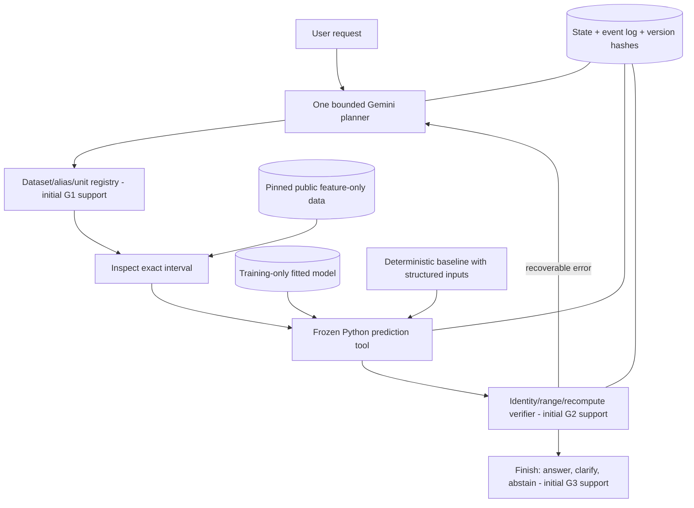

# Subsurface Agent - AI4015 Phase 1

A small **LogACF-inspired adaptation** for conventional well-log analysis. A frozen Random Forest predicts porosity (PHIF), water saturation (SW), and shale volume (VSH). One bounded Gemini agent inspects real schemas, selects approved tools, validates artifacts, and answers/clarifies/abstains. Python performs all numerical work.

This repository contains engineering code and factual execution artifacts. It is **not** a student-written Phase 1 literature review/proposal and must not be submitted as one. The assessed writing must be the group's own work.

The [Stage 7 evidence pack and writing guide](docs/stage7/README.md) maps the exact rubric to verified references, gap experiments, architecture diagrams, actual results and the proposed team responsibilities. [GitHub publication and collaboration](docs/GITHUB_PUBLISHING.md) explains the repository handoff.

## Recorded results: 16 October 2026

- **19 offline software tests passed** at the Phase 1 recording; see [results/tests.xml](results/tests.xml). After the reliability fixes below, the suite has 23 tests.
- **6/6 selected live Gemini smoke cases passed**, once each. Ten additional defined cases were not run against Gemini; this is development evidence, not a general reliability estimate.
- On **4,122 held-out rows from wells 3 and 7**, mean property RMSE was **0.051901** for the fixed Random Forest and **0.220384** for the training-mean predictor. These use the same custom split; they are not comparable to LogACF's published score.
- A real prediction/verification/plot workflow completed; all six recorded tool outputs matched during replay without an LLM request.
- After publication, **19 tests passed on each of fresh Linux and Windows GitHub runners**, including dependency installation. [Verified CI run](https://github.com/mehranwazir/ai4015-subsurface-agent/actions/runs/38919298498).

See [docs/STAGE6_STATUS.md](docs/STAGE6_STATUS.md) for exact results, limitations, evidence locations, and submission readiness. The repository is public on GitHub.

## Reproduce on Windows

Python 3.11-3.13 is supported; the recorded initial run used **Python 3.13.3 on Windows 11**. No GPU or LLM training is needed.

```powershell
cd ai4015-subsurface-agent
python -m venv .venv
.\.venv\Scripts\python.exe -m pip install -r requirements-lock.txt
.\.venv\Scripts\python.exe -m pip install --no-deps -e .
.\.venv\Scripts\python.exe -m subsurface_agent download
.\.venv\Scripts\python.exe -m subsurface_agent prepare
.\.venv\Scripts\python.exe -m subsurface_agent baseline
.\.venv\Scripts\python.exe -m pytest -q
```

Run the commands from the repository root. The code derives paths from its installed project location; no source path is hardcoded. As a no-install alternative, set `$env:PYTHONPATH='src'` and use `python -m subsurface_agent ...` with the dependencies installed.

The initial development environment reused already installed packages through `venv --system-site-packages` because sandbox temp permissions prevented the first `ensurepip` attempt. `requirements-lock.txt` records package versions actually used. Subsequent GitHub CI successfully installed these dependencies and the editable package on fresh Linux and Windows runners and passed all 19 offline tests. The full public-data training/API workflow was executed locally; it is not part of offline CI.

### Run the real agent

Copy `.env.example` to `.env`, then configure `GEMINI_API_KEY` locally. Never paste keys in issues, screenshots, commits, or results. Alternatively set an environment variable in the shell. The real `.env` is ignored by Git.

```powershell
.\.venv\Scripts\python.exe -m subsurface_agent agent 'Predict PHIF, SW and VSH for well 3 from 10600 to 11000 ft. Verify the artifact and make a plot.'
.\.venv\Scripts\python.exe -m subsurface_agent evaluate --cases predict_ft predict_m unknown_well unsupported_target repair_missing curve_alias
```

Gemini is a separate API service; a ChatGPT subscription is not an API key. Availability/quota/billing depend on your Google account. The provider does not assume a free tier, silently switch models, or claim invoice cost. On 16 October 2026, `gemini-2.5-flash-lite` listed in the models endpoint but rejected generation for this account; the service recommended `gemini-3.5-flash-lite`. The model is configurable with `--model` or `GEMINI_MODEL`. Failed runs are retained.

Each run writes `results/runs/<run-id>/result.json`, a JSONL event trace, and any CSV/plot artifacts. Each `evaluate` batch writes its own summary to `results/evaluations/<batch-id>.json`, so later batches never overwrite earlier evidence; the Phase 1 batch is preserved in `results/agent_evaluation.json`. The result includes disposition, tools/errors, token counts, latency, model/data versions, and explicit cost uncertainty.

### Replay without an LLM call

```powershell
.\.venv\Scripts\python.exe -m subsurface_agent replay results/runs/<run-id>/result.json
```

Replay reruns the recorded approved tool actions with the pinned data/model and checks exact structured outputs. This differs from asking a stochastic LLM to plan again.

## Data and split

Public source: [SPWLA PDDA 2021 organizer repository](https://github.com/pddasig/Machine-Learning-Competition-2021), commit `0ffc94f702feab81f6eb1f4d453e19754a557305`.

- Original `train.csv`: **318,967 rows / 9 well IDs (0-8)**.
- Original competition `test.csv`: **11,275 rows / 4 well IDs (100, 101, 103, 104)**.
- The organizer reference CSV lacks sample/well/depth keys. We **do not score the competition test data** or claim its official score.
- Custom evaluation cohort: finite PHIF/SW/VSH in [0,1], at least four finite input curves. **42,219 rows** qualify. **90 complete-label rows outside [0,1]** are flagged/excluded, not clipped. Missing-label rows are excluded only from supervised evaluation/training.
- Training wells **0,2,4,6,8**: **33,692 rows**.
- Validation wells **1,5**: **4,405 rows**.
- Test wells **3,7**: **4,122 rows**.
- Seven input curves: `GR, CALI, DEN, NEU, RDEP, RMED, DTC`. Well ID, depth, and target labels are not predictor inputs.
- Depth is feet according to the pinned organizer tutorial; meter requests are explicitly converted. The tutorial's DTC unit wording appears inconsistent, so no DTC unit conversion is performed.

These choices were fixed before initial scoring. The dataset is one field, the test has only two wells, and labels are interpreted reference properties. Do not claim field-independent generalization or perfect physical truth. This cohort/split is different from the base paper.

The agent reads **only** `data/processed/features.csv` and the locally trained model. Final test labels are not in its tools or state. Evaluation joins on stable sample ID, well, and depth rather than assuming row order.

## Reliability fixes after Phase 1 recording

- **Depth unit is required.** `inspect_interval` no longer defaults a missing unit to feet; it returns `MISSING_UNIT` so the planner must clarify instead of guessing. All recorded Phase 1 runs passed the unit explicitly, so their results are unaffected.
- **Versioned reference model.** Pickled forests differ byte-for-byte across Python/OS builds even when every prediction is identical. The reference model (`models/random_forest.joblib`, SHA-256 `e24f305b…`) is therefore committed. `baseline` refits the model and, when the refit reproduces the reference predictions exactly, keeps the reference file (`reference_model_reproduced: true`). Prediction IDs and replay of the recorded traces now work from a fresh clone.
- **Evaluation evidence is append-only** (see above).
- **Overlap check is reproducible.** `prepare` now regenerates `results/overlap_check.json`.

## Numerical baseline

- Training-only median imputation plus missingness indicators.
- Random Forest: 80 trees, max depth 10, min leaf size 3, seed 42, one CPU worker.
- Training-mean predictor as a simpler non-agentic comparison.
- RMSE, MAE and R² per property/well; pooled and macro-well summaries.
- No hyperparameter search or test-guided model choice.

Actual metrics: [results/baseline_metrics.json](results/baseline_metrics.json). Data/checksum/split provenance: [results/data_manifest.json](results/data_manifest.json). Figures and keyed predictions are saved under `results/`.

Agent reliability is a different outcome from prediction RMSE. The same frozen numerical tools serve the fixed workflow and the agent; any claimed orchestration improvement needs separate controlled experiments.

## Architecture



The full research gaps are **not yet validated contributions**. These are initial mechanisms and a smoke benchmark; no gap ablation/significance/calibration claim is made.

Tools: `inspect_dataset`, `inspect_interval`, `predict_properties`, `verify_predictions`, `plot_logs`, `finish`. Arguments are validated by Pydantic with unknown fields rejected. There is no arbitrary code executor, model-training tool, file-path argument, web access, or scoring-label tool. Limits are 10 model turns, 14 calls, and 3 tool errors per run.

Unknown identifiers/unsupported curves produce explicit errors. Insufficient usable samples cause abstention. Predictions must be verified before answering/plotting. The verifier establishes execution consistency, not geological correctness or calibrated uncertainty. Fault injection is explicitly labeled and only simulates a missing output artifact for the recovery case.

## Evaluation and tests

`evaluation/cases.json` contains **16 manually specified smoke cases**, not an independent validated benchmark. Cases include feet/meters, aliases, missing units, ambiguous wells, unsupported targets, missing files, tiny intervals, and test-label tuning requests. Real execution coverage is reported in `results/agent_evaluation.json`; unexecuted cases are not counted as passed.

Software tests use synthetic fixtures to check contracts, identity-safe scoring, leakage boundaries, unit conversions, artifact corruption, recovery, budget termination, provider failures, and replay. Scripted test providers are labeled test doubles and never counted as real model results. Network access is unnecessary for tests.

In some sandboxed Windows environments, the default temporary directory can be inaccessible. The recorded final test command used a fresh workspace directory:

```powershell
.\.venv\Scripts\python.exe -m pytest -q --basetemp=.tools/pytest-stage6-final-20261016 --junitxml=results/tests.xml
```

Use a new directory name if retaining earlier test scratch files. The preceding sandbox-temp failure is retained in `results/evidence/tests_sandbox_temp_failure.xml`; it was an environment setup failure, not a passing test run. Subsequent remote Linux and Windows CI both passed; [verification details](docs/stage7/ci_verification.json) identify the tested commit and scope.

## Repository layout

```text
src/subsurface_agent/   data, baseline, contracts, tools, provider, agent, evaluation, CLI
tests/                 offline unit/integration tests
evaluation/            manually labeled workflow smoke cases
docs/                  scientific protocol and development status
data/raw/              ignored public downloads; recreated by download command
data/processed/        ignored prepared tables; recreated by prepare command
models/                versioned reference Random Forest and its manifest
results/               actual metrics, figures, validation outputs
results/evidence/      selected real traces/artifacts retained for review
```

Published repository: [mehranwazir/ai4015-subsurface-agent](https://github.com/mehranwazir/ai4015-subsurface-agent). Source, tests, actual results and the Stage 7 evidence pack are public, and the first Windows/Linux CI run passed. Recheck access/state before submission. Group members must add their own real contributions; commit history must not be fabricated.

## Attribution and comparison limits

Base paper: Luo, G. and Xiao, L.-Z. (2026), [Large language model-based AI agent for well logging data processing and interpretation](https://doi.org/10.1016/j.petsci.2026.05.031), *Petroleum Science*.

Data background: Fu et al. (2024), [Well-Log-Based Reservoir Property Estimation With Machine Learning: A Contest Summary](https://doi.org/10.30632/PJV65N1-2024a6), *Petrophysics* 65(1), 108-127. This 2024 background paper does not count toward the assignment's ten 2025-26 papers.

This code was written for the student project; author LogACF code was inspected for research but not copied. We simplify agent roles, freeze the prediction model, use native typed tools, use another provider/model, and change the split. **Our score must not be presented as outperforming LogACF's reported score.**

See [NOTICE.md](NOTICE.md) for the organizer's noncommercial/share-alike data terms. Do not treat public data availability as an unrestricted code/data license.
