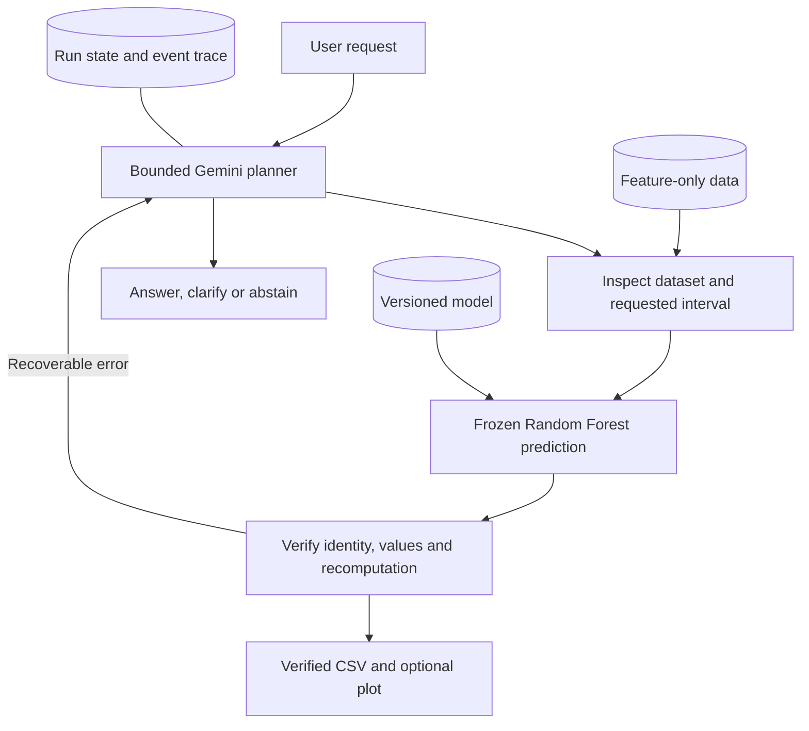

# Reliable Tool-Using Agents for Well-Log Analysis

AI4015 Agentic Artificial Intelligence, Fall 2026 - Phase 1, Group G3-03.

This project uses a Gemini agent to coordinate well-log analysis. Given a well and a depth interval, it inspects the available curves, runs a fixed Random Forest to estimate porosity (PHIF), water saturation (SW) and shale volume (VSH), verifies the prediction file, and creates a plot when requested. Python handles the numerical work; the agent chooses the next tool based on the request and the tool results.

The project is inspired by [LogACF](https://doi.org/10.1016/j.petsci.2026.05.031). We focus on one conventional well-log workflow with a public dataset, one planner and predefined tools. The current implementation provides the working baseline for the Phase 1 report, *Reliable Tool-Using Agents for Well-Log Analysis*. Controlled comparisons of the proposed reliability mechanisms are planned for the next phase.

## Phase 1 results

The public-data baseline and live Gemini runs were recorded on 16 October 2026. Numerical evaluation uses 4,122 held-out rows from wells 3 and 7. All target values are fractions.

| Target | Training-mean RMSE | Random Forest RMSE | Random Forest MAE | Random Forest R-squared |
| --- | ---: | ---: | ---: | ---: |
| PHIF | 0.071320 | 0.021597 | 0.013402 | 0.876463 |
| SW | 0.357893 | 0.070118 | 0.031695 | 0.902511 |
| VSH | 0.231938 | 0.063989 | 0.050770 | 0.914726 |
| Mean property RMSE | 0.220384 | 0.051901 | - | - |

The last row is the arithmetic mean of the three pooled property RMSEs. Results vary by well: water saturation on well 7 has RMSE 0.092671 and R-squared 0.259237. Full pooled and per-well results are in [baseline_metrics.json](results/baseline_metrics.json). These scores describe the numerical predictor on our custom split; they do not measure an accuracy gain from using an agent or establish a comparison with LogACF's published score.

The recorded agent evaluation includes:

- Six selected live Gemini cases, each run once: feet, meters, an unknown well, an unsupported target, a missing prediction file and a curve alias. All six passed their specified checks. Ten other defined cases were not run live.
- A separate prediction, verification and plotting run for well 3 from 10,600 to 11,000 ft, producing 1,220 prediction rows in six tool calls with no tool errors.
- Replay of that run with all six structured tool outputs matching, without another LLM call.

See the [recorded evaluation](results/agent_evaluation.json), [successful workflow](results/evidence/gemini-e2e-002/result.json) and [replay result](results/evidence/replay.json). The live cases are development smoke tests, not a blinded reliability benchmark.

The current software suite has **23 passing tests**, including the four tests added after the original 19-test recording. [Windows and Linux CI](https://github.com/mehranwazir/ai4015-subsurface-agent/actions/runs/39028167942) passed the extended suite. CI uses synthetic fixtures and a scripted provider; it does not run full public-data training or call Gemini.

## Setup

Python 3.11-3.13 is supported. The recorded environment used Python 3.13.3 on Windows 11. The numerical model runs on CPU; a GPU is not required.

The commands below use PowerShell:

```powershell
git clone https://github.com/mehranwazir/ai4015-subsurface-agent.git
cd ai4015-subsurface-agent
python -m venv .venv
.\.venv\Scripts\python.exe -m pip install -r requirements-lock.txt
.\.venv\Scripts\python.exe -m pip install --no-deps -e .
.\.venv\Scripts\python.exe -m pytest -q
```

The tests run without a dataset download or API key. On Linux or macOS, use `.venv/bin/python` in place of `.\.venv\Scripts\python.exe`.

### Prepare the data and reproduce the baseline

```powershell
.\.venv\Scripts\python.exe -m subsurface_agent download
.\.venv\Scripts\python.exe -m subsurface_agent prepare
.\.venv\Scripts\python.exe -m subsurface_agent baseline
```

`download` retrieves the pinned public archive. `prepare` creates the feature table and supervised splits, records their checksums, and regenerates the train/test feature-overlap check. `baseline` fits and scores the Random Forest and training-mean predictor, then writes metrics, keyed predictions and plots under `results/`.

The reference Random Forest and its manifest are tracked under `models/`. Its SHA-256 is `e24f305b1458fab9189be704db162fd0ed68a25fd7f433ff3f0ace6f618c197e`. When a fresh fit produces exactly the same predictions on the validation and test feature rows, `baseline` keeps the reference file and reports `reference_model_reproduced: true`. This preserves the model identity used by recorded prediction IDs and replay across environments.

### Run the agent

Copy `.env.example` to `.env` and set `GEMINI_API_KEY`. The recorded runs used `gemini-3.5-flash-lite`; the model can be changed with `GEMINI_MODEL` or `--model` to one available to your account. The `.env` file is ignored by Git. Live runs require Gemini API access and are subject to your account's quota and billing.

```powershell
Copy-Item .env.example .env
# Edit .env and add your API key before running the next command.
.\.venv\Scripts\python.exe -m subsurface_agent agent 'Predict PHIF, SW and VSH for well 3 from 10600 to 11000 ft. Verify the artifact and make a plot.'
```

Include the depth unit in the request. Missing units, ambiguous well identifiers and unsupported targets require clarification. Unknown wells or insufficient usable data lead to abstention.

Each run saves `result.json`, an event trace and any prediction or plot files in `results/runs/<run-id>/`. Records include the final disposition, tool calls, errors, data/model versions, token usage and loop latency. Billing cost is recorded as unknown unless separately established; optional price inputs produce an estimate only.

To run the same six cases selected for the Phase 1 evaluation:

```powershell
.\.venv\Scripts\python.exe -m subsurface_agent evaluate --cases predict_ft predict_m unknown_well unsupported_target repair_missing curve_alias
```

Each new batch writes a separate summary to `results/evaluations/<batch-id>.json`. The original Phase 1 summary remains in `results/agent_evaluation.json`. New planner runs can differ from the recorded runs.

### Replay a recorded workflow

After preparing the pinned data, the committed reference model can be used to replay the saved workflow without an API key:

```powershell
.\.venv\Scripts\python.exe -m subsurface_agent replay results/evidence/gemini-e2e-002/result.json
```

Replay repeats the saved tool actions and checks their structured outputs under matching data/model versions. It does not ask Gemini to create a new plan. Plot bytes may vary with rendering versions.

## Data and numerical model

The dataset is the [SPWLA PDDA Machine Learning Competition 2021 release](https://github.com/pddasig/Machine-Learning-Competition-2021), derived from Volve data and pinned to commit `0ffc94f702feab81f6eb1f4d453e19754a557305`.

The original training CSV has 318,967 rows from nine well IDs. The supervised cohort requires finite PHIF, SW and VSH values within [0,1] and at least four finite input curves. It contains 42,219 rows. Ninety complete-label rows with out-of-range targets are excluded rather than clipped.

| Split | Well IDs | Eligible rows |
| --- | --- | ---: |
| Training | 0, 2, 4, 6, 8 | 33,692 |
| Validation | 1, 5 | 4,405 |
| Test | 3, 7 | 4,122 |

The seven inputs are `GR`, `CALI`, `DEN`, `NEU`, `RDEP`, `RMED` and `DTC`. Well ID and depth are alignment keys, not predictor inputs. Depth is stored in feet; declared meter intervals are converted explicitly. No DTC conversion is applied because the organizer tutorial's unit wording is inconsistent.

The Random Forest uses training-only median imputation with missingness indicators, 80 trees, maximum depth 10, minimum leaf size 3, seed 42 and one CPU worker. Hyperparameters and the well split were fixed before initial scoring. The simpler comparison predicts the training mean for each target.

The organizer's separate competition test file has 11,275 rows, but its reference target file lacks well/depth identity keys. We do not score that file or report an official competition result. Source hashes, filtering counts and split details are in [data_manifest.json](results/data_manifest.json). The [overlap check](results/overlap_check.json) found no exact training/test feature-vector matches; this does not establish independence between related wellbores.

## Agent workflow



The available tools are `inspect_dataset`, `inspect_interval`, `predict_properties`, `verify_predictions`, `plot_logs` and `finish`. Pydantic validates arguments and rejects unknown fields. The depth unit is mandatory. Prediction requires at least ten usable rows and 60% input coverage; these are demonstration rules, not calibrated confidence thresholds.

The agent reads the feature-only table and the frozen model. Reference target labels remain with the independent offline scorer. Predictions must pass verification before a successful prediction answer or plot. Verification checks artifact identity, finite values, bounds and agreement with model recomputation; it cannot establish geological correctness.

A run is limited to 10 planner turns, 14 tool calls and three tool errors. A missing prediction file can be regenerated and verified within that budget. The tool registry provides no arbitrary code execution, model fitting or access to scoring labels. See [ARCHITECTURE.md](docs/ARCHITECTURE.md) for state and tool details.

## Next phase and limitations

The report proposes three comparisons: semantic grounding of wells, curves and units (G1); artifact verification with bounded repair (G2); and answer, clarification or abstention decisions based on available evidence (G3). Initial mechanisms are implemented. Matched controls, ablations and a larger scenario benchmark remain planned; their benefits have not yet been measured.

The current data comes from one field, with only two held-out test wells and interpreted reference labels. The numerical results do not establish transfer to other fields. Six successful live cases do not establish general agent reliability, and the acceptance rules do not provide calibrated uncertainty. Production forecasting, reservoir simulation, permeability prediction and economics are outside the current scope.

The [experiment protocol](docs/EXPERIMENT_PROTOCOL.md) documents scoring, leakage controls and comparison limits. Supporting literature and research notes are collected in [docs/stage7/](docs/stage7/README.md).

## Repository layout

```text
src/subsurface_agent/   data preparation, model, tools, agent, evaluation and CLI
tests/                 offline software tests with synthetic fixtures
evaluation/            16 defined development smoke cases
docs/                  architecture, protocol and research notes
data/raw/              downloaded source data, excluded from Git
data/processed/        prepared tables, excluded from Git
models/                reference Random Forest and its manifest
results/               recorded metrics, predictions and figures
results/evidence/      retained live traces, artifacts and replay results
results/runs/          new local runs, excluded from Git
```

## Project team

| Member | Roll number | Responsibility |
| --- | --- | --- |
| Mehran Hamayoon | 22i-0810 | Group head; data and numerical model |
| Abdul Basit | 22i-0866 | Agent and tool integration |
| Talha Araiz | 22i-0796 | Evaluation and reliability |

## References and data terms

- Luo, G. and Xiao, L.-Z. (2026). [Large language model-based AI agent for well logging data processing and interpretation](https://doi.org/10.1016/j.petsci.2026.05.031). *Petroleum Science*. The project adapts its workflow idea; it does not reproduce the full LogACF system or use copied author code.
- Fu et al. (2024). [Well-Log-Based Reservoir Property Estimation With Machine Learning: A Contest Summary](https://doi.org/10.30632/PJV65N1-2024a6). *Petrophysics*, 65(1), 108-127. Dataset background.

The organizer states Attribution-NonCommercial-ShareAlike terms for the data. Raw and processed datasets are downloaded or regenerated rather than committed. See [NOTICE.md](NOTICE.md) for attribution and third-party data terms.
