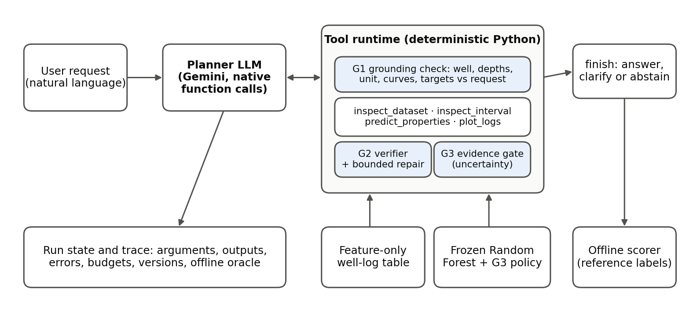

# Architecture

## Components

| Part | File | Role |
|---|---|---|
| Planner loop | `src/subsurface_agent/agent.py` | Sends the request, the system prompt and the tool schema to the LLM; runs each tool call it returns; feeds the result back; stops at `finish` or when a budget runs out; saves the run record |
| LLM provider | `src/subsurface_agent/providers.py` | Gemini REST native function calling (mode ANY), explicit temperature and seed, request pacing and rate-limit waits; the API key never enters a trace |
| Tool contracts | `src/subsurface_agent/contracts.py` | Pydantic schemas for the six tools; unknown fields are rejected; no file paths |
| Tool runtime | `src/subsurface_agent/tools.py` | Executes `inspect_dataset`, `inspect_interval`, `predict_properties`, `verify_predictions`, `plot_logs`, `finish`; calls the gap components; keeps the run state |
| G1 grounding | `src/subsurface_agent/gaps/grounding.py` | Extracts the well, depths, unit, curves and requested quantities from the user's text; rejects tool arguments the user did not state, intervals outside the well, and answers that would drop an unsupported part of the request; adds a dataset registry and checklist to the prompt |
| G2 verification | `src/subsurface_agent/gaps/verification.py` | Checks each prediction file: columns, sample/well/depth identity, duplicates, finite values, [0, 1] bounds and agreement with a recomputation by the frozen model; allows two regenerations per interval |
| G3 acceptance | `src/subsurface_agent/gaps/acceptance.py` | Computes the spread of the 80 trees' predictions for the interval; blocks `finish(answer)` above the limit calibrated on validation wells 1 and 5 (`models/g3_policy.json`); adds an evidence rule to the prompt |
| Configurations | `src/subsurface_agent/config.py` | Switches for each component (`full`, `no_g1`, `no_g2`, `no_g3`) and the comparison presets |
| Faults | `src/subsurface_agent/faults.py` | Seven controlled faults and one benign control, applied once to the first prediction file; hidden from the planner |
| Comparison systems | `src/subsurface_agent/baselines/` | B0 fixed script (no LLM); B2 LogACF-style planner, executor and LLM reviewer |
| Runner and scorer | `src/subsurface_agent/experiments.py`, `scoring.py` | Resumable runs of systems x cases x repeats; independent scoring from traces, the offline oracle and reference labels |

## State and trace

During a run the runtime holds:
- the original request and the facts G1 extracted from it;
- the provider conversation;
- inspected slices and prediction files, with their G3 evidence;
- the IDs of verified predictions and repair attempts per slice;
- the remaining budget;
- the injected fault, if any.

Each run saves `result.json`, which records:
- the disposition, reason and configuration;
- usage (requests, tokens, active latency and throttle time), plus the data and model versions;
- the offline oracle (fault applied, validity of every final file);
- the full trace.

It also saves `events.jsonl` (one line per tool call) and the prediction files. Replay re-runs the recorded tool calls without the LLM and checks that every output matches.

## Boundaries

- **Budgets:** 10 planner turns, 14 tool calls and 3 tool errors per run.
- **What the agent can read:** only the feature table (no labels) and the frozen model. Reference labels are read only by the offline scorer and the G3 calibration (validation wells only).
- **What the agent cannot do:** run arbitrary code, fit a model, use file-path arguments or browse the web.
- **When a prediction is refused:** it needs at least 10 usable rows and 60% input coverage in every configuration. With G2 on, answers and plots need a verified file. With G3 on, answers need uncertainty within the calibrated limit.
- **Provider failures:** a failure ends the run as `failed` and stops an experiment batch. Rerunning the command resumes, and the failed attempt is kept.
