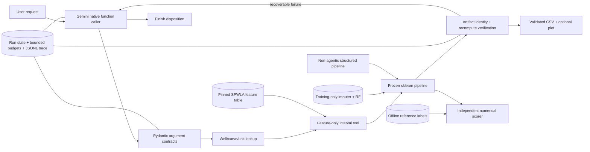

# Implemented architecture and semester extensions

## Current Phase 1 system

The offline scorer is not in the agent tool registry. Agent state consists of the original query, native provider conversation, inspected slices, prediction metadata, verified artifact IDs, remaining budgets, tool errors, source/model versions, disposition and usage. The saved trace includes approved actions/results rather than provider credentials or private reasoning text.

## Gap mapping

| Candidate contribution | Initial implementation | Still needed for the research claim |
|---|---|---|
| G1 semantic grounding | Actual dataset registry, aliases, explicit feet/meters conversion, typed argument validation. | Systematic adversarial/ambiguous queries and comparisons with/without semantic grounding. |
| G2 verification/repair | One-to-one artifact identities, finite/range checks, frozen-model recomputation, recoverable missing-file feedback. | Broader fault families, no-review/LLM-review/detection-only comparisons, bounded-cost ablations. |
| G3 acceptance under inadequate evidence | Explicit answer/clarify/abstain and minimum input sufficiency rules. | Validation-tuned policies, matched-coverage comparisons, risk–coverage evaluation. |
| Reproducibility | Pinned data, split/model hashes, saved action traces, no-LLM replay. | Repeated fresh planner runs, cross-environment checks, reproducibility statistics. |

The extra reliability mechanisms are not all experimentally validated improvements. The numerical baseline and the agent use the same model/tool computations, so agent use alone does not imply improved prediction RMSE.

## Operational boundaries

- Maximum 10 planner turns, 14 tool calls, 3 tool errors per run.
- At most two HTTP attempts for selected transient provider errors.
- Well/depth requests require an existing well, valid interval, declared unit, and sufficient input data.
- Known aliases normalize deterministically; unknown names remain errors.
- Artifacts stay inside the project run directory; no path arguments are exposed to the LLM.
- Predictions require verification before successful answer/plot operations.
- No LLM training or GPU requirement; Gemini performs planning, CPU Python performs science.
- A provider failure saves a failed run and halts the evaluation batch.
