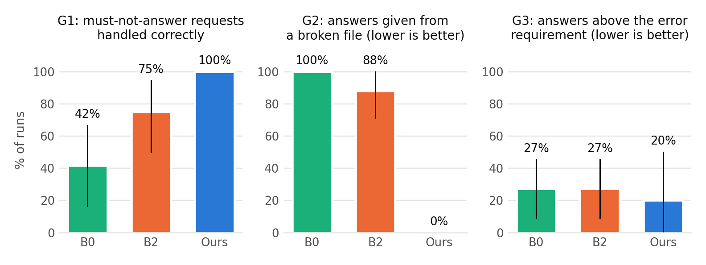
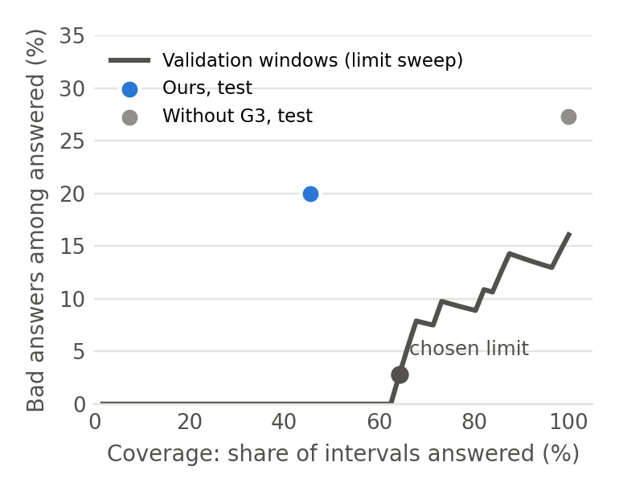
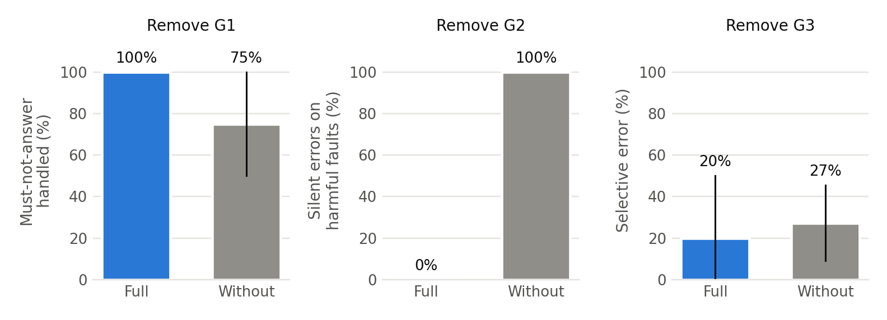

# Phase 2 results

This report covers the final evaluation (experiments E1 to E6) on the test benchmark. Every number comes from files in this repository:
- the full tables: [`results/final/tables.md`](../results/final/tables.md), plus one CSV per table in `results/final/tables/`;
- the scored runs: [`results/experiments/final/runs.csv`](../results/experiments/final/runs.csv);
- the saved traces of all 566 runs: [`logs/evidence/final/`](../logs/evidence/final/);
- figures: `results/final/figures/`.

## How the evaluation was run

- **Benchmark.** 50 test cases on test wells 3 and 7, generated by `experiments/build_benchmark.py`:
  - 22 prediction requests on a fixed 100 ft grid;
  - 16 artifact-fault cases: 14 harmful, plus 2 benign controls (rows shuffled, which a correct checker must accept);
  - 12 requests that must not be answered as asked: missing unit, vague well, unknown well, out-of-range depths, unsupported quantities.
- **Frozen system.** The system was frozen before any test run (devlog entry 7).
- **Model and settings.** Gemini `gemini-3.5-flash-lite`, temperature 1.0, seed equal to the repeat number. Every LLM system ran three times; B0 has no LLM and ran once.
- **Ablations.** Each ablation ran only on the cases of its own gap: 34 G1 cases, 16 fault cases, 22 prediction cases.
- **Scoring.** The independent scorer (`scoring.py`) never trusts a system's own claim. A run is **task-correct** only if all of these hold:
  - its outcome (answer, clarify or abstain) is allowed for the case;
  - it did not answer from an invalid file;
  - any reported prediction has mean property RMSE of at most 0.05 against the reference labels;
  - for complete requests, it answered when the interval's reference error was at most 0.05 and refused when it was above.
- **Uncertainty.** Results show the mean, ± the standard deviation across repeats, then a 95% bootstrap interval over cases in brackets.

## E1. Baselines

**Numerical baseline, test wells (4,122 rows).** The fixed Random Forest has mean property RMSE **0.0519**, against **0.2204** for the training-mean predictor. LogACF reports 0.07423 under a different protocol, so the two are not comparable.

**Non-agentic pipeline (B0).** B0 completes every fully specified request, but it cannot ask questions or check files:
- task success **46.0%** [32.0, 60.0];
- it answered all 14 harmful-fault cases from broken files.

## E2 and E3. Base-paper approach and proposed system

| Metric (%) | B0 fixed pipeline | B2 LogACF-style | Proposed |
|---|---|---|---|
| Task success, all 50 cases | 46.0 | 57.3 ± 1.2 | **76.0** [64.0, 88.0] |

On the same cases, the proposed system is:
- **+30.0 points** better than B0 [+10.0, +50.0];
- **+18.7 points** better than B2 [-0.7, +36.7].

The interval against B2 just includes zero, so the overall gain over B2 is likely but not certain with 50 cases. The per-gap differences below are clearer.

## E4. Results per gap

### G1: grounding (do not guess what the user did not say)

| Metric (%) | B0 | B2 | Proposed |
|---|---|---|---|
| Must-not-answer requests handled correctly | 41.7 | 75.0 ± 8.3 | **100.0** |
| Unwarranted answers on those requests | 41.7 | 19.4 ± 4.8 | **0.0** |
| Missing-unit requests clarified | 0.0 | 0.0 | **100.0** |
| Interval arguments correct | 100.0 | 100.0 | 100.0 |

- When no unit was given, B0 and B2 always assumed feet. The proposed system asked every time.
- The gain over B2 on must-not-answer requests is **+25.0 points** [+5.6, +50.0].

### G2: verification and repair (do not answer from a broken file)

| Metric (%) | B0 | B2 | Proposed |
|---|---|---|---|
| Harmful faults detected | 0.0 | 11.9 ± 4.1 | **100.0** |
| Answers given from a broken file (silent errors) | 100.0 | 88.1 ± 4.1 | **0.0** |
| Harmful faults repaired | 0.0 | 11.9 ± 4.1 | **100.0** |
| False alarms on the benign control | 0.0 | 0.0 | 0.0 |

B2's LLM reviewer approved most broken files, even when the file's row count or values plainly differed from the run log. The deterministic verifier caught every fault type, and bounded regeneration repaired every one.

### G3: acceptance (do not answer when the prediction is likely wrong)

Of the 22 prediction intervals, 16 have reference error within 0.05 and 6 are above it.

| Metric (%) | B0 | B2 | Proposed |
|---|---|---|---|
| Prediction requests answered (coverage) | 100.0 | 100.0 | 45.5 |
| Answers above the 0.05 requirement (selective error) | 27.3 | 27.3 | **20.0** [0.0, 50.0] |
| Acceptable intervals refused (false refusal) | 0.0 | 0.0 | 50.0 |
| Poor intervals refused (justified abstention) | 0.0 | 0.0 | 66.7 |

What this shows:
- **Gain.** The uncertainty gate refused 4 of the 6 poor intervals and cut the bad-answer rate from 27.3% to 20.0%.
- **Cost.** It also refused half of the acceptable intervals.

**The calibration did not transfer well.** On the validation wells, the chosen limit gave 2.8% bad answers at 64.3% coverage. On the test wells it gave 20.0% at 45.5%.

## E5. Ablation

Each ablation is compared with the full system on exactly the same cases.

| Removed | Metric (%) | Full | Without |
|---|---|---|---|
| G1 | Must-not-answer requests handled | 100.0 | 75.0 |
| G1 | Unwarranted answers | 0.0 | 16.7 |
| G1 | Task success on the 34 G1 cases | 70.6 | 61.8 |
| G2 | Silent errors on harmful faults | 0.0 | 100.0 |
| G2 | Task success on harmful-fault cases | 85.7 | 0.0 |
| G3 | Selective error | 20.0 | 27.3 |
| G3 | Coverage | 45.5 | 100.0 |
| G3 | Task success on prediction cases | 54.5 | 72.7 |

- **G1 and G2 each add a large, clear benefit.** Note that without G1, the prompt registry is also gone, and the planner still clarified some requests on its own.
- **Removing G3 raises task success on prediction cases.** The 24 refusals of acceptable intervals (8 cases × 3 repeats) outweigh the 12 bad answers it prevented (4 poor intervals × 3). G3 lowers the error of the answers that are given, but on this test set the net effect is negative.

## E6. Efficiency and reliability

| System | LLM requests per run | Prompt tokens per run | Tool calls per run | Provider failures |
|---|---|---|---|---|
| B0 | 0 | 0 | 3.82 | 0 |
| B2 | 1.91 | 3,063 | 5.20 | 0 |
| Proposed | 4.67 | 10,150 | 4.54 | 0 |

On matched cases:
- **G1 and G3 make runs cheaper**, because they stop early:
  - G1: 3.58 vs 4.04 requests;
  - G3: 4.62 vs 5.33 requests.
- **G2 makes runs more expensive** on fault cases, because of repair: 7.26 vs 5.17 requests.

**Consistency.** Across the three repeats, the proposed system gave the same outcome on all 50 cases. B2 changed its outcome on 3 cases.

**Latency is only a rough measure here.** Runs were spread over three API projects with different response times (`results/final/tables/e6_latency_by_project.csv`). Requests and tokens are the reliable cost measures. Pacing and rate-limit waits are excluded from all latency figures.

## Gap-resolution table

The "base paper result" is our LogACF-style adaptation (B2), reproduced by us on the same data, cases and metrics. LogACF itself reports no results for these three gaps.

| Gap | Method / component | Metric | Base paper result | Our result | Addressed? |
|---|---|---|---|---|---|
| G1 semantic grounding | Request-to-argument check and dataset registry (`gaps/grounding.py`) | Must-not-answer requests handled; unwarranted answers | 75.0%; 19.4% | 100.0%; 0.0% | Fully |
| G2 verification and repair | Artifact verifier with bounded regeneration (`gaps/verification.py`) | Silent errors on harmful faults; faults repaired | 88.1%; 11.9% | 0.0%; 100.0% | Fully |
| G3 acceptance under weak evidence | Uncertainty gate calibrated on validation wells (`gaps/acceptance.py`) | Selective error; coverage; false refusals | 27.3%; 100.0%; 0.0% | 20.0%; 45.5%; 50.0% | Partially |

### Against the Phase 1 hypotheses

- **H1 (G1).** Target: at least +10 points on perturbed requests, losing no more than 5 points on normal requests.
  - **Result: +25 points.** No loss on normal requests: task success on the 22 normal prediction requests is 54.5% both with and without G1, and every interval call used the correct arguments.
  - **Supported.**
- **H2 (G2).** Target: at least 50% fewer silent errors.
  - **Result: 100% fewer** than both B2 and the G2 ablation.
  - **Supported.**
- **H3 (G3).** Target: 25% lower selective error at a common coverage.
  - **Result:** 27% lower selective error, but at 45.5% coverage against 100%. Over the whole set of prediction requests, task success fell.
  - **Partially supported.**

## Failure analysis

See [`docs/FAILURE_ANALYSIS.md`](FAILURE_ANALYSIS.md).
- All 36 failed runs of the proposed system are G3 acceptance errors:
  - 24 refusals of acceptable intervals;
  - 12 answers on intervals above the error requirement.
- It made no G1 or G2 errors.
- The document includes two success and two failure trajectories, step by step.

## Limitations

- **One field.** Results come from one oil field (Volve, SPWLA 2021 data), with two test wells.
- **Small G3 evidence.** G3 rests on only 6 poor intervals, so its intervals are wide.
- **Synthetic faults.** The faults are injected and labelled by design. Real-world file problems may look different.
- **One LLM.** Only one model was tested.
- **Mixed API projects.** Runs used three API projects, two of them on the free tier. This affects latency, but not outcomes or token counts.
