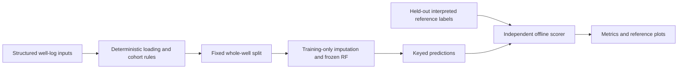
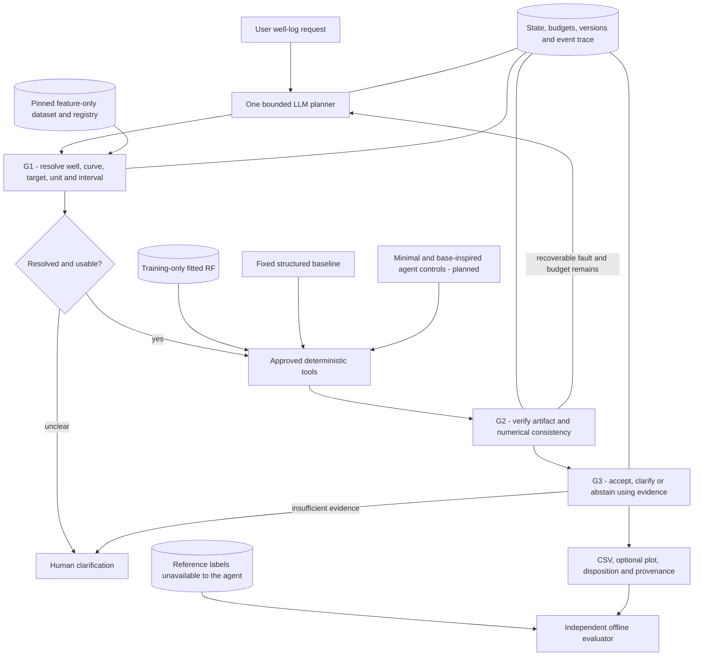

# Proposal outline: prompts for the group's own writing

Use the headings/questions below to prepare Deliverable B. They mirror assignment Section 5 and its continuation. Do not submit this outline or convert these notes mechanically into assessed prose.

## 1. Title and selected seed

- State G3-03 and choose your own narrow title.
- Make the workflow recognizable: well-log data, reservoir-property prediction and reliable tool use.
- Avoid a title promising production forecasting, economics or the full Geo/Production/Economy framework.

## 2. Problem and motivation — B1

Explain who the intended analyst is, what scripts/data/actions they currently combine, and what failures matter. Use a concrete well/interval task. Explain the cost of wrong units, wrong well identity, unusable inputs or a misleading successful-looking artifact. Identify the limits of a research prototype.

## 3. Base paper and three selected gaps — A2/A5, B3

Identify P01 and ranking proof; explain why its task/data are a practical anchor. Connect the three measured uncertainties to named-paper evidence. Distinguish the base-inspired adaptation from exact reproduction, and existing related techniques from a proposed empirical contribution. Use [gap experiment notes](03_BASE_PAPER_AND_GAPS.md) as evidence to reason about, not final submission text.

## 4. Target product/system

Define an observable end-of-semester workflow: natural-language request, bounded tool operations, results/artifacts, trace and appropriate answer/clarification/abstention. Explain who resolves an ambiguous request. Identify the deliberately excluded features.

## 5. Why agentic behavior — B1

Compare three cases: a fully specified clean query suited to a fixed pipeline; an ambiguous query requiring clarification; a recoverable artifact failure requiring another action. Explain what the LLM chooses, what Python computes, and how the project will measure whether flexibility justifies latency/cost. Do not claim fixed pipelines are inherently inadequate.

## 6. Goals and success criteria

Separate development goals (working interfaces, reproducibility, artifact visibility) from research goals (measured semantic/recovery/acceptance improvements). State a criterion for each gap. Treat the proposed numerical targets as hypotheses to justify, not results, guarantees or course rules.

## 7. Confirmed data/environment/source — B3

Report the pinned organizer source, seven features and three targets, actual cohort counts, invalid-label exclusions, whole-well split and interpreted reference-label limitation. Explain why the competition test set is not scored. State Windows/Python/CPU execution and the separately hosted Gemini planner. Include attribution/data-use terms.

## 8. Architecture, state and controls — B2

Describe the planner, tool contracts, dataset/alias registry, frozen model, verifier, finish policy, trace and external provider. State data/state boundaries and which outputs humans see. Explain budgets and recoverable versus terminal errors. Describe optional retrieval only if needed; none is implemented now.

### Existing deterministic baseline

This baseline's numerical training/scoring is executed. It does not accept an unrestricted natural-language request or demonstrate an orchestration improvement.

### Proposed research architecture and gap locations

Current code has initial G1/G2/G3 mechanisms; comparative variants, broader policies and ablations are future work. The existing Mermaid source in this file is an editable engineering reference. Verify the final diagram yourselves and make its implemented/planned distinction clear in your submission.

## 9. Baselines — B3

Identify the training-mean/RF numerical comparison already run. Separately define the planned minimal agent and literature-linked planning/review comparison under the same tools/data/model/budgets. Explain why published paper numbers from a different protocol are not fair direct comparisons. Avoid naming the current guarded agent as an unguarded ablation baseline.

## 10. Research questions and hypotheses — B3

For G1, G2 and G3, state one narrow empirical question, one directional prediction, the unit of analysis, comparator and dependent measure. Name any prespecified success target. Confirm each proposed experiment fits the semester.

## 11. Evaluation, ablations and system measures — B3

Distinguish property prediction from workflow correctness. Specify sample/well/scenario splits, prompt development, locked evaluation, label isolation, fault oracles, denominator definitions, repeated-run plan and uncertainty. Include per-well results, clean-case regressions, false refusals, recovery costs, token/latency counts and billing uncertainty. Describe full-minus-component comparisons and how essential safety/validity remains intact.

## 12. Milestones, feasibility and fallbacks — B4

Use relative milestones until the semester calendar is confirmed:

| Milestone | Evidence of completion | Main owner |
|---|---|---|
| Phase 1 handoff | Reproduced baseline, reviewed original PDF, accessible repository | All; head coordinates |
| Freeze numerical protocol | Data/model/split checks, own failure analysis | Mehran |
| Grounding and control variants | Documented argument/registry policies, comparable budgets | Abdul |
| Fault/scenario benchmark | Independent labels/oracles and held-out scenario families | Talha |
| Repair/acceptance ablations | Matched variants, repeated runs, raw counts/costs | Abdul + Talha |
| Final scientific analysis | Per-well results, honest limitations, shared interpretation | Mehran + all |

Map these to actual dates after checking course milestones. Risks to discuss: limited field/well diversity, interpreted labels, missing source tables, API quota/availability, stochastic planning, clean-install portability and mistaken novelty. Fallbacks: retain CPU RF; use canonical schemas; preserve recorded real runs for demonstration; use offline software tests when API unavailable; label replay or test doubles honestly. Model changes require separate evaluation.

## 13. Work division — B4

Use [the team plan](06_TEAM_AND_SUBMISSION.md): Mehran data/model, Abdul agent/tools, Talha evaluation/reliability. Explain measurable deliverables and shared understanding. Do not claim every member authored the initial assistant-built code or invent member commits.

## 14. Potential publication direction — B4

Decide what evidence would make the work useful: a public task/fault benchmark, controlled reliability measurements, failure analyses and a small reproducible implementation. Discuss conditions and limitations. Publication is an aspiration, not a Phase 1 guarantee.

## 15. Initial implementation/results and references

Select factual tables/figures from [executed results](05_EXECUTED_RESULTS.md), explain what they show yourselves, and cite the repository artifacts and relevant papers. Do not present the six developer cases as a held-out research benchmark. Import the checked BibTeX into a reference manager, choose IEEE style and verify citation order, author corrections and online publication details.
